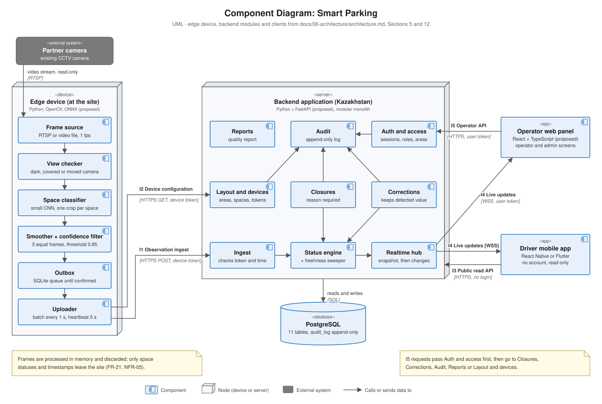

# Component Diagram

UML component diagram of the pilot: the components inside the edge device and the backend application, the two client apps, the database, and the interfaces between them.

**Source:** `docs/06-architecture/architecture.md`, Section 5 (components) and Section 12 (interfaces). Keep both in sync.

## Edge device (at the site)

| Component | Responsibility | Requirements |
|---|---|---|
| Frame source | Reads the camera stream at 1 frame per second; can read a recorded video file for repeatable tests | FR-16 |
| View checker | Detects a dark frame, a covered lens or a moved camera; lost view → affected spaces `unknown` | FR-19 |
| Space classifier | Crops each space by its polygon and classifies it as `occupied` or `free` with a confidence value | FR-16 |
| Smoother + confidence filter | Confidence below 0.85 → `unknown`; a new state is reported after 3 equal consecutive frames | FR-17, FR-18 |
| Outbox | Stores every observation in a local SQLite queue; deletes it after the server confirms | NFR-03 |
| Uploader | Sends a batch every second and the full state at least every 5 s; downloads the layout | FR-06, FR-16 |

## Backend application (Kazakhstan)

| Component | Responsibility | Owns data | Requirements |
|---|---|---|---|
| Ingest | Checks the device token and time, stores observations, passes them on | `observation` | FR-16, FR-20, NFR-03 |
| Status engine | Computes the displayed state; sweeper marks stale spaces `unknown` every second | `space_state`, `state_history` | FR-04, FR-05, FR-20 |
| Realtime hub | Sends a snapshot on connect, then changes | — | FR-05, FR-06 |
| Auth and access | Login, sessions with 15-min idle timeout, roles, area checks | `user_account`, `user_area` | FR-09, NFR-09 |
| Closures | Opens and removes closures; rejects an empty reason | `closure` | FR-07, FR-10, FR-11 |
| Corrections | Creates, removes and expires corrections; keeps the detected value | `correction` | FR-12 |
| Audit | Writes and reads the append-only log | `audit_log` | FR-13, NFR-04 |
| Reports | Quality report for a period | reads `state_history`, `observation`, `correction` | FR-15 |
| Layout and devices | Areas, spaces, polygons, devices, tokens | `area`, `space`, `device` | FR-01 |

Modules talk to each other only through their public functions, never through each other's tables.

## Clients and storage

| Element | Description |
|---|---|
| Driver mobile app | React Native or Flutter; no account; loads data over I3, then live updates over I4; applies the 30-second freshness rule itself (FR-08) |
| Operator web panel | React + TypeScript (proposed); operator screens and admin screens (role `admin`) over I5 and I4 |
| PostgreSQL | One database for all modules; `audit_log` is append-only (no UPDATE or DELETE rights for the application user) |

## Interfaces

| ID | Interface | Between | Protocol and access |
|---|---|---|---|
| I1 | Observation ingest | Uploader → Ingest | HTTPS POST, device token |
| I2 | Device configuration | Uploader → Layout and devices | HTTPS GET, device token |
| I3 | Public read API | Driver mobile app → Backend | HTTPS REST, no login, rate limited |
| I4 | Live updates | Realtime hub → both apps | WSS; public for drivers, token for operators |
| I5 | Operator and admin API | Operator web panel → Auth and access → modules | HTTPS REST, user token |

Endpoints and message formats are described in `docs/06-architecture/architecture.md`, Section 12.
