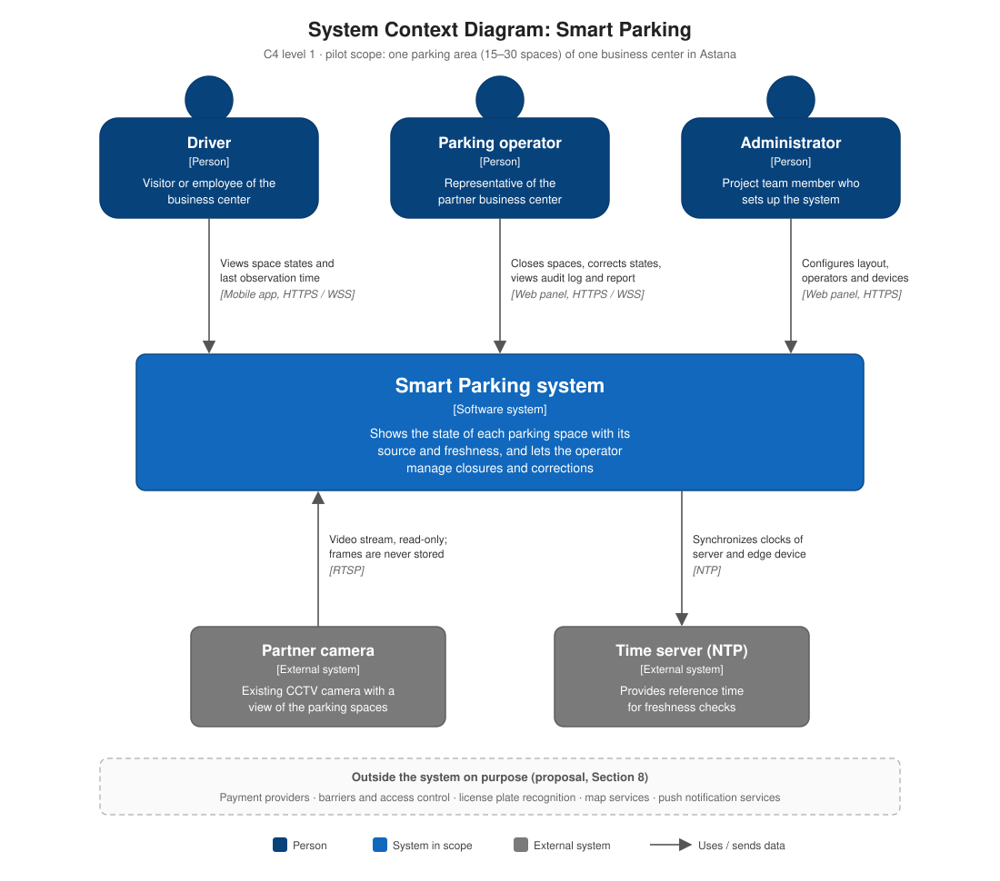

# System Context Diagram

C4 level 1 view of the pilot: the Smart Parking system is shown as one box, and everything outside it is a person or an external system.

**Source:** `docs/06-architecture/architecture.md`, Section 3. Keep both in sync.

| Element | Type | How it interacts | Data exchanged |
|---|---|---|---|
| Driver | Person | Mobile app, read-only, no account | Space states, timestamps, closure reasons |
| Parking operator | Person | Web panel, logged in | Closures, corrections, audit log, history, quality report |
| Administrator | Person | Web panel, `admin` role | Layout, space polygons, operator accounts, device tokens |
| Partner camera | External system | Edge device reads its stream (RTSP) | Video frames, processed in memory and never stored |
| Time server (NTP) | External system | Edge device and server sync their clocks | Time only |

**Outside the system on purpose** (proposal, Section 8): payment providers, barriers and access control, license plate recognition, map services, push notification services.
