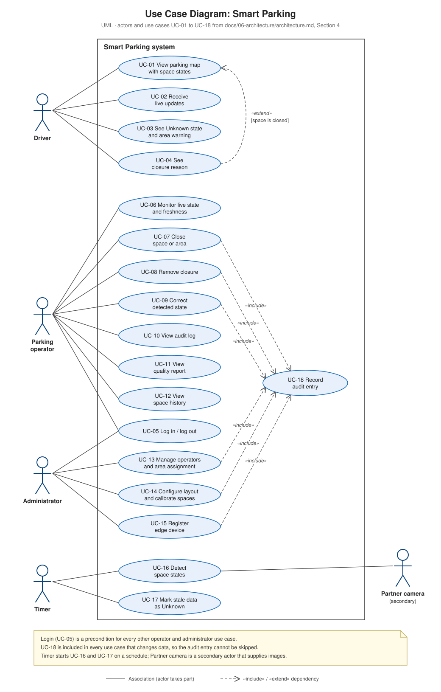

# Use Case Diagram

UML use case diagram of the pilot: who uses the Smart Parking system and for what. Primary actors are on the left; the secondary actor (Partner camera) is on the right.

**Source:** `docs/06-architecture/architecture.md`, Section 4. Keep both in sync.

## Actors

| Actor | Type | Description |
|---|---|---|
| Driver | Primary | Visitor or employee of the business center; uses the mobile app without an account |
| Parking operator | Primary | Representative of the partner business center; uses the web panel |
| Administrator | Primary | Project team member who sets up layout, operators and devices |
| Timer | Primary | Starts scheduled processing (detection and staleness check) |
| Partner camera | Secondary | Supplies images for detection; frames are never stored |

## Use cases

| ID | Use case | Actor | Requirements |
|---|---|---|---|
| UC-01 | View parking map with space states | Driver | FR-01, FR-02, FR-03 |
| UC-02 | Receive live updates | Driver | FR-06 |
| UC-03 | See Unknown state and area warning | Driver | FR-04, FR-05, FR-08 |
| UC-04 | See closure reason | Driver | FR-07 |
| UC-05 | Log in / log out | Operator, Administrator | FR-09, NFR-09 |
| UC-06 | Monitor live state and freshness | Operator | FR-14 |
| UC-07 | Close space or area | Operator | FR-10 |
| UC-08 | Remove closure | Operator | FR-11 |
| UC-09 | Correct detected state | Operator | FR-12 |
| UC-10 | View audit log | Operator | FR-13, NFR-04 |
| UC-11 | View quality report | Operator | FR-15 |
| UC-12 | View space history | Operator | FR-20 |
| UC-13 | Manage operators and area assignment | Administrator | Supports FR-09 |
| UC-14 | Configure layout and calibrate spaces | Administrator | Supports FR-01, FR-16 |
| UC-15 | Register edge device | Administrator | Supports FR-16 |
| UC-16 | Detect space states | Timer, Partner camera | FR-16 – FR-19, FR-21 |
| UC-17 | Mark stale data as Unknown | Timer | FR-04, FR-05 |
| UC-18 | Record audit entry | System (included) | FR-13 |

## Relationships

- **«include»:** UC-07, UC-08, UC-09, UC-13, UC-14 and UC-15 include UC-18, so every change of data writes an audit entry automatically.
- **«extend»:** UC-04 extends UC-01 when the selected space is closed.
- **Login** (UC-05) is a precondition for every other operator and administrator use case, not an included use case.

Main and alternative flows for each use case are described in `docs/06-architecture/architecture.md`, Section 4.3.
