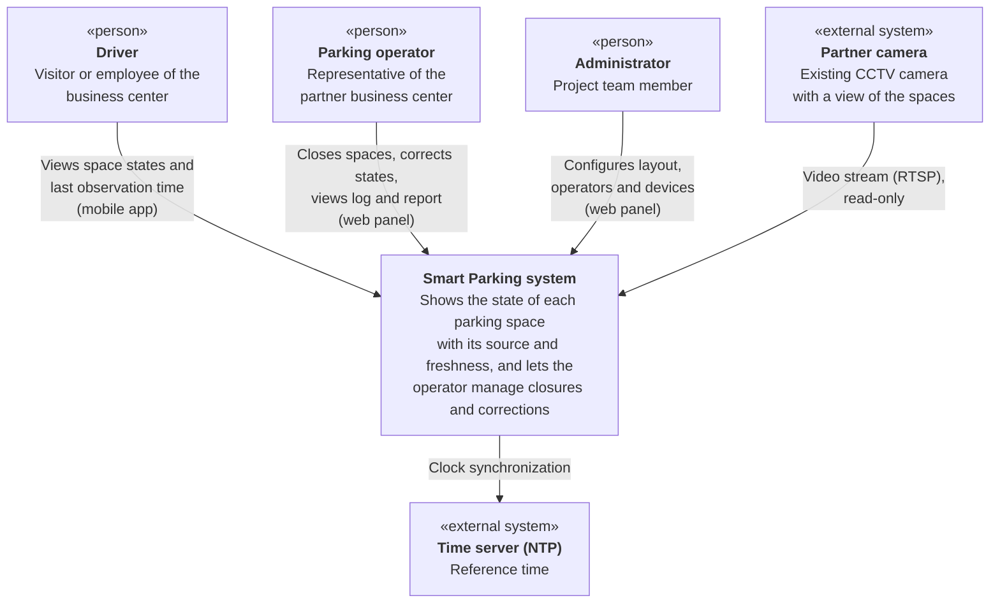
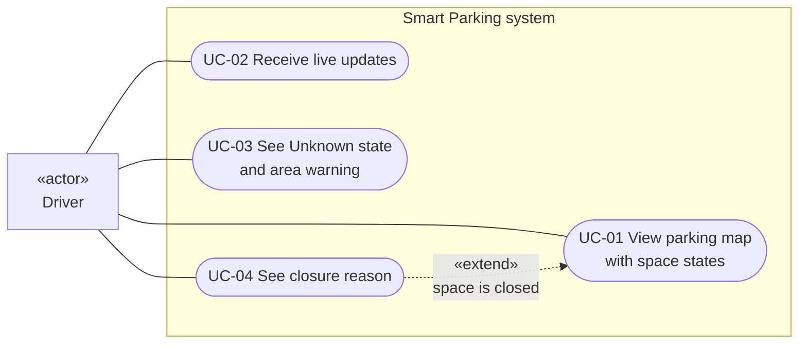
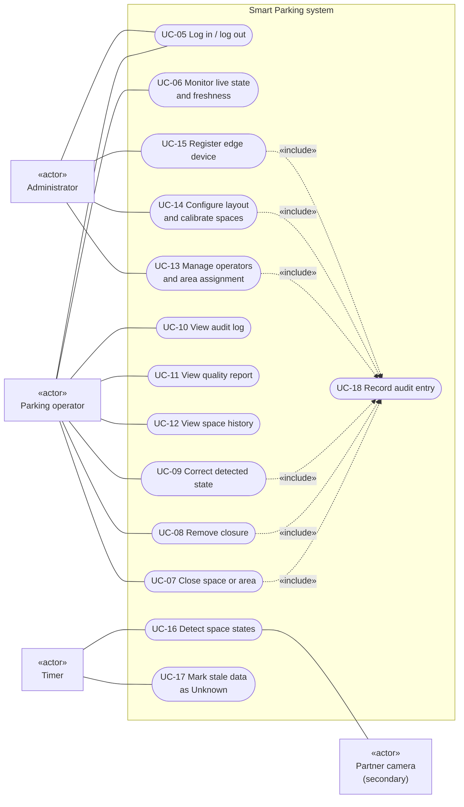
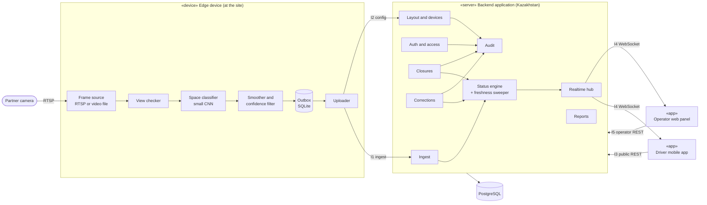
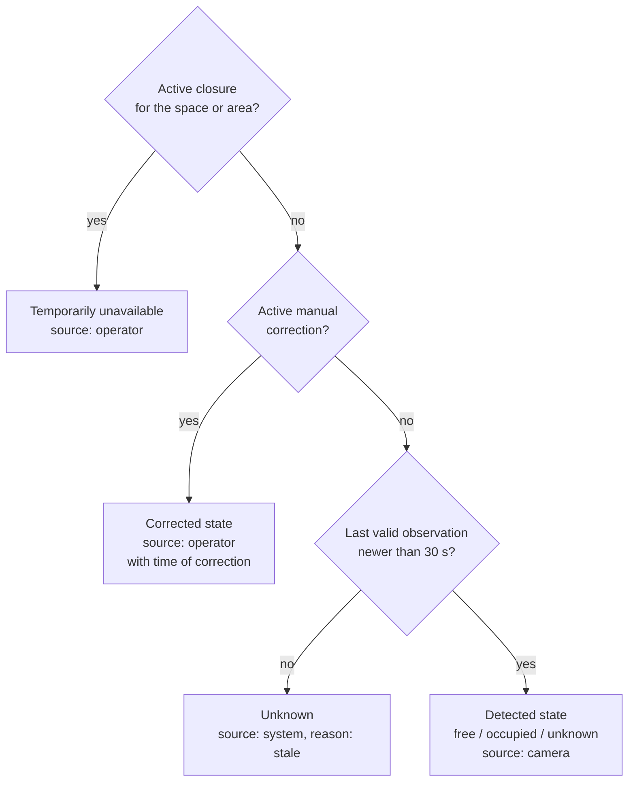
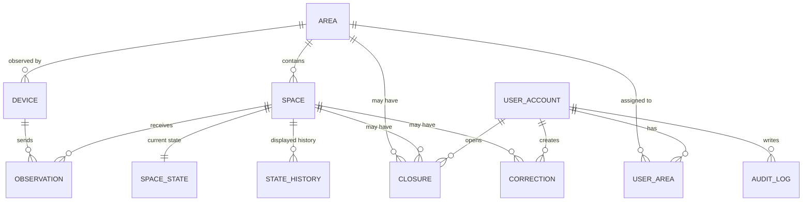
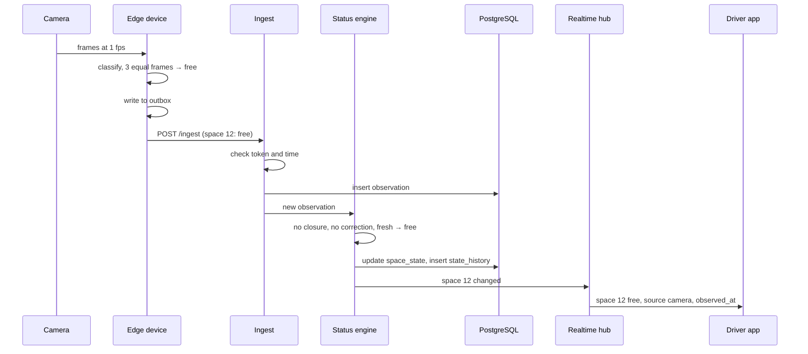
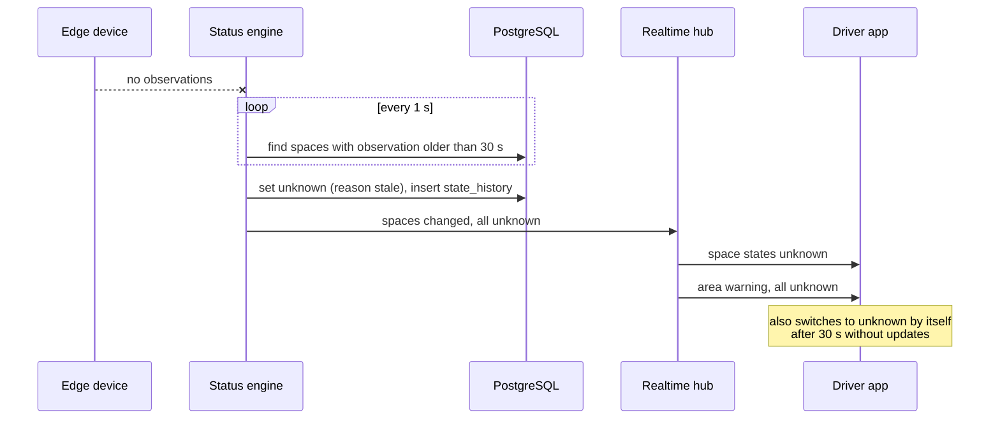
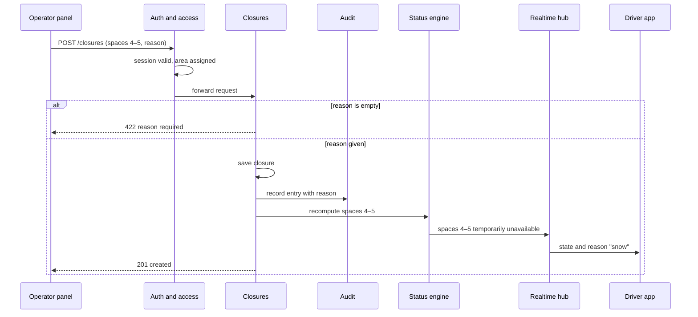
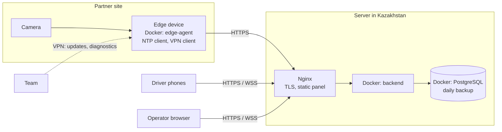

# System Architecture

**Project:** Smart Parking Mobile App: trustworthy parking availability monitoring for one parking area (15–30 spaces) of a business center in Astana.
**Author:** Ansar Keles (backend and architecture).
**Status:** draft for review. Items marked **(proposed)** are not decided yet and must be confirmed by the team before development starts.

**References:**
- Scope: `docs/01-proposal/proposal.md`, Section 8.
- Technology decisions: `docs/04-technology_comparison/technology_comparison.md`.
- Requirements: `docs/05-requirements/requirements.md`.
- Verification: `docs/08-verification_plan/vreification_plan.md`.

---

## 1. Summary
The system shows drivers the state of each parking space (free, occupied, temporarily unavailable, or unknown) together with the source of the information and how fresh it is. Operators close spaces, correct wrong states, and review data quality.

**Architecture in one sentence:** an **edge device** at the site turns camera images into space statuses, a **single backend application** in Kazakhstan decides what to display and enforces freshness, and a **mobile app** and an **operator web panel** receive updates in real time.

**Key decisions:**

| # | Decision | Main reason |
|---|---|---|
| AD-1 | Images are processed only on an edge device at the site | Images never leave the site (FR-21, NFR-05); works when the internet is unstable (NFR-03) |
| AD-2 | One backend application split into modules (modular monolith) | A team of two cannot operate several services; pilot load is small |
| AD-3 | Freshness is enforced in three places: edge, backend, app | Stale data must never be shown as current, whichever link fails (FR-04, FR-08) |
| AD-4 | Displayed state is computed by fixed precedence: closure → correction → fresh detection → unknown | One clear rule, easy to test and explain (FR-10, FR-12, FR-04) |
| AD-5 | REST for loading, WebSocket for live changes | Changes appear without refresh within seconds (FR-06, NFR-02) |
| AD-6 | PostgreSQL with an append-only audit log | Structured history and a log that cannot be changed (FR-13) |
| AD-7 | Drivers have no accounts | No driver personal data in the system (NFR-05) |

Section 9 gives each decision with its alternatives.

---

## 2. Architectural Drivers

| Driver | Source | Consequence |
|---|---|---|
| Stale data must never be shown as current | FR-04, FR-08, FR-18, FR-19 | AD-3: three independent freshness checks |
| Status change visible within seconds | FR-06, NFR-02 | AD-5; edge classifies at 1 frame per second (Section 10) |
| Camera images must not be stored or sent | FR-21, NFR-05 | AD-1: all image processing at the site |
| Unstable internet at the site | NFR-03 | Edge stores observations locally and resends them |
| Operator actions must be traceable | FR-12, FR-13, NFR-04 | AD-6: append-only audit log |
| Personal data stored in Kazakhstan | NFR-06 | Server hosted in Kazakhstan; AD-7 |
| Team of two, limited time | Proposal, Section 8 | AD-2: one application, one database, Docker Compose |

---

## 3. System Context Diagram
The system is shown as one box. Everything outside it is a person or an external system.



| Element | Type | How it interacts | Data exchanged |
|---|---|---|---|
| Driver | Person | Mobile app, read-only, no account | Space states, timestamps, closure reasons |
| Parking operator | Person | Web panel, logged in | Closures, corrections, audit log, history, quality report |
| Administrator | Person | Web panel, `admin` role | Layout, space polygons, operator accounts, device tokens |
| Partner camera | External system | Edge device reads its stream | Video frames, processed in memory and never stored |
| Time server (NTP) | External system | Edge device and server sync their clocks | Time only |

**Outside the system on purpose** (proposal, Section 8): payment providers, barriers and access control, license plate recognition, map services, push notification services.

---

## 4. Use Case Diagram
The diagram is split in two for readability. Primary actors are on the left; secondary actors (who support a use case but do not start it) are on the right.

### 4.1 Driver



### 4.2 Operator, administrator, and system



**Notes on the diagram:**
- **Login is a precondition**, not an included use case: every operator and administrator use case except UC-05 requires an active session.
- **UC-18 Record audit entry** is included in every use case that changes data, so the log is written by the system automatically and cannot be skipped.
- **Timer** is the primary actor of UC-16 and UC-17: both run on a schedule, not on a person's request. The camera is a secondary actor that supplies images.

### 4.3 Use case descriptions

| ID | Use case | Actor | Main flow | Alternative flow | Requirements |
|---|---|---|---|---|---|
| UC-01 | View parking map with space states | Driver | Opens the app; sees every space with its state, source, and last observation time | No connection on start: app shows "no data" and no states | FR-01, FR-02, FR-03 |
| UC-02 | Receive live updates | Driver | Keeps the app open; changes appear without refresh | Connection drops: app reconnects and reloads the snapshot | FR-06 |
| UC-03 | See Unknown state and area warning | Driver | Data older than 30 s → space shows Unknown; all spaces Unknown → warning | — | FR-04, FR-05, FR-08 |
| UC-04 | See closure reason | Driver | Taps a closed space; sees the reason | No reason entered: shows "closed by operator" | FR-07 |
| UC-05 | Log in / log out | Operator, Administrator | Enters login and password | Wrong password: rejected; 15 min idle: session ends | FR-09, NFR-09 |
| UC-06 | Monitor live state and freshness | Operator | Sees all spaces of assigned areas with timestamps and device health | — | FR-14 |
| UC-07 | Close space or area | Operator | Selects spaces, enters reason, saves | Empty reason: rejected | FR-10 |
| UC-08 | Remove closure | Operator | Removes a closure; spaces return to their detected state | — | FR-11 |
| UC-09 | Correct detected state | Operator | Sets the correct state with a reason; expires after 15 min unless removed earlier | Empty reason: rejected | FR-12 |
| UC-10 | View audit log | Operator | Sees who changed what, when, and why; no edit or delete | — | FR-13, NFR-04 |
| UC-11 | View quality report | Operator | Picks a period; sees Unknown share, correction count, confidence summary | Period without data: empty report with a note | FR-15 |
| UC-12 | View space history | Operator | Picks a space and range; sees displayed states over time | — | FR-20 |
| UC-13 | Manage operators and area assignment | Administrator | Creates accounts, assigns areas | — | Supports FR-09 |
| UC-14 | Configure layout and calibrate spaces | Administrator | Draws polygons on a reference image and positions on the map | — | Supports FR-01, FR-16 |
| UC-15 | Register edge device | Administrator | Creates a device and gets its token once | — | Supports FR-16 |
| UC-16 | Detect space states | Timer, Partner camera | Every second: frame → classification → smoothing → observation sent | Low confidence or lost view → Unknown | FR-16 – FR-19, FR-21 |
| UC-17 | Mark stale data as Unknown | Timer | Every second: spaces without a fresh observation → Unknown | — | FR-04, FR-05 |
| UC-18 | Record audit entry | System (included) | Saves user, time, action, before/after, reason | — | FR-13 |

UC-13 to UC-15 and correction expiry are not in the requirements yet, but the system cannot be set up or used safely without them and should be added to the requirements.

---

## 5. Component Diagram (draft)



### 5.1 Edge device

| Component | Responsibility | Requirements |
|---|---|---|
| Frame source | Reads the camera stream at 1 frame per second. Can read a recorded video file instead, for repeatable tests. | FR-16 |
| View checker | Detects a dark frame, a covered lens, or a moved camera (brightness, sharpness, fixed landmarks on a reference image). Lost view → affected spaces `unknown`. | FR-19 |
| Space classifier | Crops each space by its polygon and classifies it as `occupied` or `free` with a confidence value. | FR-16 |
| Smoother and confidence filter | Confidence below the threshold → `unknown` (starts at 0.85, tuned on the validation set). A new state is reported after 3 equal consecutive frames. | FR-17, FR-18 |
| Outbox | Writes every observation to a local SQLite queue before sending; deletes it after the server confirms. | NFR-03 |
| Uploader | Sends a batch every second; sends the full state of all spaces at least every 5 s as a heartbeat; downloads the layout. | FR-06, FR-16 |

Frames are processed in memory and discarded. Image saving is off by default (FR-21).
**Language (proposed):** Python with OpenCV and ONNX Runtime, the same language as the ML code.

### 5.2 Backend

| Component | Responsibility | Owns data | Interface | Requirements |
|---|---|---|---|---|
| Ingest | Checks the device token and time (Section 6.4), stores observations, passes them on | `observation` | I1 | FR-16, FR-20, NFR-03 |
| Status engine | Computes the displayed state (Section 6); sweeper runs every second; records every displayed change | `space_state`, `state_history` | internal | FR-04, FR-05, FR-20 |
| Realtime hub | Sends a snapshot on connect, then changes | — | I4 | FR-05, FR-06 |
| Auth and access | Login, password hashes, sessions with 15-min idle timeout, roles, area checks | `user_account`, `user_area` | I5 | FR-09, NFR-09 |
| Closures | Opens and removes closures; rejects an empty reason | `closure` | I5 | FR-07, FR-10, FR-11 |
| Corrections | Creates, removes, and expires corrections; keeps the detected value | `correction` | I5 | FR-12 |
| Audit | Writes and reads the append-only log | `audit_log` | I5 | FR-13, NFR-04 |
| Reports | Quality report for a period | reads `state_history`, `observation`, `correction` | I5 | FR-15 |
| Layout and devices | Areas, spaces, polygons, devices, tokens | `area`, `space`, `device` | I2, I3, I5 | FR-01 |

Modules talk to each other only through their public functions, never through each other's tables. This keeps the monolith easy to split later if needed.
**Framework (proposed):** Python with FastAPI (see AD-8 in Section 9).

### 5.3 Clients

**Driver mobile app** (React Native or Flutter, decided by the team)
- No account; reads public data only.
- On start: loads layout and states over REST, then subscribes over WebSocket.
- Applies the 30-second freshness rule itself, so it shows `unknown` even without a network (FR-08).
- Shows an area warning when all spaces are `unknown` (FR-05).

**Operator web panel** (proposed: React with TypeScript)
- Operator screens: live map with timestamps and device health, closures, corrections, audit log, history, quality report.
- Admin screens (role `admin`): operators and assignments, layout calibration, devices.

---

## 6. Status Model

### 6.1 Displayed state



1. **Closure** always wins: the operator decided the space cannot be used.
2. **Correction** overrides the camera until it is removed or expires after **15 minutes** (proposed). A short expiry stops an old correction from looking like current data if the camera fails. The app shows when the correction was made.
3. **Detection** is used only while fresh. Older than 30 s → `unknown`.

Every displayed state carries its **source** (camera, operator, system), its **time**, and, for `unknown`, a **reason** (`stale`, `low_confidence`, `view_lost`).

### 6.2 Freshness enforcement (AD-3)

| Where | Rule | Protects against |
|---|---|---|
| Edge device | Low confidence or lost view → `unknown` | Bad or missing image (FR-18, FR-19) |
| Backend sweeper | Every 1 s: last valid observation older than 30 s → `unknown`, change published | Edge device or site internet down (FR-04) |
| Mobile app | No update for a space within 30 s → shown as `unknown` | Phone network down (FR-08) |

### 6.3 Late data after reconnection
Buffered observations arrive with their original times (NFR-03). All are stored as history, but only an observation younger than 30 s can change the displayed state. A buffered "free" from ten minutes ago is never shown as current.

### 6.4 Clock synchronization
Freshness depends on `observed_at`, set by the edge device. A device clock running ahead would make old data look fresh.
- Edge device and server sync with NTP.
- Ingest compares `observed_at` with the server's `received_at`: more than 2 s in the future → rejected and the device is flagged; older than 30 s on arrival → history only.
- A flagged device stops updating its spaces, so the sweeper turns them `unknown`, and the operator panel shows the fault.

---

## 7. Data Model



| Table | Main columns | Notes |
|---|---|---|
| `area` | id, name, freshness_limit_s (30) | One area in the pilot |
| `space` | id, area_id, label, polygon (JSON), map_x, map_y | Polygon for the edge device, position for the apps |
| `device` | id, area_id, token_hash, last_seen_at, clock_error | Edge device identity and health |
| `observation` | id, space_id, device_id, observed_at, received_at, state, confidence, reason | Raw camera results; unique on (device_id, space_id, observed_at) |
| `space_state` | space_id, state, source, reason, state_time, updated_at | One row per space: what the apps show now |
| `state_history` | id, space_id, state, source, reason, started_at | One row per displayed change, including sweeper changes |
| `closure` | id, area_id or space_id, reason, opened_by, opened_at, closed_by, closed_at | `reason` NOT NULL |
| `correction` | id, space_id, detected_state, corrected_state, reason, created_by, created_at, expires_at, removed_at | Keeps the original detected value (FR-12) |
| `user_account` | id, login, password_hash, role | Roles: `operator`, `admin` |
| `user_area` | user_id, area_id | Areas a user may see and edit (FR-09) |
| `audit_log` | id, user_id, action, target, before, after, reason, created_at | Append-only: the application database user has INSERT and SELECT only |

**Why `state_history` is separate from `observation`:** `observation` holds only what the camera saw. When a space becomes `unknown` because nothing arrived, there is no observation, yet drivers saw `unknown`. History (FR-20) and the Unknown share in the report (FR-15) need the displayed state, not only the camera's.

**Volume and retention:** changes plus a heartbeat every 5 s give about 30 × 17,280 ≈ 520,000 observation rows per day, which PostgreSQL handles without special tools. Raw observations are kept for 90 days (proposed); `state_history`, `closure`, `correction`, and `audit_log` are kept for the whole pilot. No table stores images, license plates, or driver identities.

---

## 8. Key Scenarios
Each sequence shows how components work together in a scenario from the verification plan.

### 8.1 A car leaves a space (TS-01, FR-06, NFR-02)



### 8.2 The camera stops sending (TS-02, FR-04, FR-05)



### 8.3 The operator closes spaces for snow (TS-06, TS-07, FR-10, FR-13)



### 8.4 The edge device loses internet for 10 minutes (TS-12, NFR-03)

```mermaid
sequenceDiagram
    participant EDGE as Edge device
    participant BOX as Outbox
    participant ING as Ingest
    participant ENG as Status engine

    EDGE--xING: internet down
    Note over ENG: sweeper turns spaces unknown after 30 s
    loop while offline
        EDGE->>BOX: store observations
    end
    EDGE->>ING: internet back, send batches in order
    ING->>ING: older than 30 s → history only
    ING->>ENG: newest observations → current state
    EDGE->>BOX: delete sent observations after 200 OK
```

---

## 9. Architecture Decisions

| ID | Decision | Alternatives considered | Why this one | Consequences |
|---|---|---|---|---|
| AD-1 | Image processing on an edge device at the site | Cloud processing; hybrid | Images stay on site (FR-21, NFR-05); works offline (NFR-03); less traffic | Hardware to install and maintain; needs remote updates (Section 11.2) |
| AD-2 | Modular monolith backend | Microservices | Two developers, one site, small load; one deploy and one database | Modules must keep clear boundaries (Section 5.2) |
| AD-3 | Freshness enforced at edge, backend, and app | Backend only | Each link can fail separately; one check cannot cover all of them | Same rule in three places; tested by TS-02, TS-03, TS-11 |
| AD-4 | Fixed precedence: closure → correction → fresh detection → unknown | Last write wins | Predictable, testable, explainable to drivers | Corrections need an expiry |
| AD-5 | REST + WebSocket | Polling; manual refresh | Change in seconds without draining battery (technology comparison, Decision 5) | Reconnect logic and snapshot on connect |
| AD-6 | PostgreSQL, append-only audit log | MongoDB; time-series database | Relations between spaces, corrections, and log; database rights protect the log | Schema migrations needed |
| AD-7 | No driver accounts | Accounts with login | Requirements do not need driver identity; no driver personal data | No personal features (favorites, notifications) in the pilot |
| AD-8 | FastAPI (proposed) | NestJS (Node.js) | Same language as edge and ML; REST and WebSocket built in; OpenAPI docs generated | To be recorded in the technology comparison |

---

## 10. Quality Attributes

### 10.1 Latency budget (NFR-02)
NFR-02 allows a median of 3 s from a physical change to the app. FR-17 requires 3 equal frames before a change. At one frame every 5 s, smoothing alone would take 10–15 s, so the edge device classifies at **1 frame per second**.

| Step | Expected time |
|---|---|
| Smoothing: 3 frames at 1 fps | about 2–3 s |
| Inference for 15–30 crops | under 0.3 s (to be measured) |
| Upload | under 0.3 s |
| Status engine and push | under 0.2 s |
| **Total, typical** | **about 3 s** |

There is no margin. If the measured median is above 3 s, the options are 2 fps capture, a shorter smoothing window, or relaxing NFR-02. Measured in Stage C of the verification plan.

### 10.2 Failure behaviour
The system's rule for every failure is the same: **show `unknown`, never a wrong state**.

| Failure | Detected by | What drivers see | What the operator sees |
|---|---|---|---|
| Camera dark, covered, or moved | Edge view checker | Affected spaces `unknown` (view_lost) | Reason on the live map |
| Model unsure | Edge confidence filter | Space `unknown` (low_confidence) | Reason on the live map |
| Edge device off or site internet down | Backend sweeper | All spaces `unknown` + area warning | Device last seen time |
| Edge device clock wrong | Ingest time check | Spaces `unknown` after 30 s | Device flagged with clock error |
| Phone loses network | Mobile app check | Spaces `unknown` after 30 s, last update time shown | — |
| Backend server down | Mobile app check | Spaces `unknown`, "no connection" | Panel unavailable |
| Database down | Backend health check | Same as server down | Same |

### 10.3 Security and personal data
- **Edge device:** unique token per device, stored hashed; may call only I1 and I2.
- **Users:** argon2 or bcrypt password hashes; token with 15-minute idle timeout (NFR-09); every operator request checks `user_area` (FR-09); admin functions need the `admin` role.
- **Drivers:** no accounts, no personal data; public endpoints are rate limited.
- **Audit:** no UPDATE or DELETE rights on `audit_log` for the application database user (FR-13).
- **Transport:** HTTPS and WSS only.
- **Images:** processed on the edge device in memory only (FR-21).
- **Hosting:** server in the Republic of Kazakhstan (NFR-06); provider to be confirmed with the supervisor.

### 10.4 Testability
- The edge frame source can play a recorded video instead of the live stream, so TS-02 to TS-05 run the same way every time, including injected single-frame errors.
- The status engine is a pure function of (closures, corrections, last observation, current time) and is unit-tested without a database.
- The backend exposes its OpenAPI schema, used to test the mobile app and panel against a mock server.

---

## 11. Deployment and Operations



### 11.1 Runtime
- One virtual server with Docker Compose: Nginx, backend, PostgreSQL. Daily database backup.
- The edge device runs one container that starts automatically after power loss.
- Edge hardware (proposed): mini PC or Jetson-class board, chosen after inference time is measured.
- Logs and uptime checks measure availability (NFR-10).
- CI (proposed: GitHub Actions) runs tests on every pull request.

### 11.2 Remote updates
The edge device connects to the team over a VPN (proposed: WireGuard or Tailscale). A new model or fix is installed by pulling a new container image, without a site visit.

### 11.3 Accepted trade-off
One server is a single point of failure. This is accepted for the pilot: the availability target is 95% (NFR-10), and when the server is down drivers see `unknown`, not wrong data (Section 10.2).

---

## 12. Interfaces

| ID | Interface | Between | Protocol and access |
|---|---|---|---|
| I1 | Observation ingest | Edge → Ingest | HTTPS POST, device token |
| I2 | Device configuration | Edge → Layout and devices | HTTPS GET, device token |
| I3 | Public read API | Mobile app → Backend | HTTPS REST, no login, rate limited |
| I4 | Live updates | Realtime hub → apps | WSS; public for drivers, token for operators |
| I5 | Operator and admin API | Operator panel → Backend | HTTPS REST, user token |

### 12.1 I1: observation ingest
`POST /api/v1/ingest/observations`, header `Authorization: Device <token>`.

```json
{
  "device_id": "edge-01",
  "sent_at": "2026-11-12T08:15:03Z",
  "observations": [
    { "space_id": 12, "observed_at": "2026-11-12T08:15:02Z", "state": "occupied", "confidence": 0.97 },
    { "space_id": 13, "observed_at": "2026-11-12T08:15:02Z", "state": "unknown", "confidence": 0.61, "reason": "low_confidence" }
  ]
}
```

Idempotent by (`device_id`, `space_id`, `observed_at`): a retry does not create duplicates.

### 12.2 I3 and I5: REST endpoints

| Method and path | Access | Purpose | Use case |
|---|---|---|---|
| `GET /api/v1/areas/{id}` | public | Layout | UC-01 |
| `GET /api/v1/areas/{id}/states` | public | Current states with source, time, reason | UC-01, UC-06 |
| `POST /api/v1/auth/login`, `POST /api/v1/auth/logout` | public / user | Session | UC-05 |
| `POST /api/v1/closures`, `DELETE /api/v1/closures/{id}` | operator | Open or remove a closure | UC-07, UC-08 |
| `POST /api/v1/corrections`, `DELETE /api/v1/corrections/{id}` | operator | Create or remove a correction | UC-09 |
| `GET /api/v1/audit?area_id=&from=&to=` | operator | Audit log | UC-10 |
| `GET /api/v1/reports/quality?area_id=&from=&to=` | operator | Quality report | UC-11 |
| `GET /api/v1/spaces/{id}/history?from=&to=` | operator | State history | UC-12 |
| `POST /api/v1/users`, `PUT /api/v1/users/{id}/areas` | admin | Operators and assignments | UC-13 |
| `PUT /api/v1/areas/{id}/spaces` | admin | Layout and polygons | UC-14 |
| `POST /api/v1/devices` | admin | Register a device; token shown once | UC-15 |

### 12.3 I4: WebSocket
`/ws/areas/{id}`. On connect the server sends a full snapshot, then only changes:

```json
{ "type": "space_state", "space_id": 12, "state": "unknown", "source": "system", "reason": "stale", "state_time": "2026-11-12T08:14:31Z" }
{ "type": "area_warning", "area_id": 1, "all_unknown": true }
```

After a reconnect the client gets a new snapshot, so a missed message cannot leave it with an old state.

---

## 13. Alignment Check

Requirements → use cases → components → data → scenarios:

| Requirement | Use case | Components | Data | Test scenario |
|---|---|---|---|---|
| FR-01 Map with states | UC-01 | Mobile app, Layout, Status engine | `space`, `space_state` | TS-01 |
| FR-02 States visually distinct | UC-01 | Mobile app | — | **none yet** |
| FR-03 Last observation time | UC-01 | Mobile app, Status engine | `space_state.state_time` | **none yet** |
| FR-04 Stale → Unknown | UC-03, UC-17 | Status engine, Mobile app | `space_state`, `state_history` | TS-02 |
| FR-05 Area warning | UC-03 | Status engine, Realtime hub, Mobile app | `space_state` | TS-02 |
| FR-06 Update without refresh | UC-02 | Realtime hub | — | **none yet** |
| FR-07 Closure reason shown | UC-04 | Closures, Mobile app | `closure.reason` | TS-06 |
| FR-08 Brief network loss | UC-03 | Mobile app | — | TS-11 |
| FR-09 Area-based access | UC-05, UC-13 | Auth and access | `user_area` | TS-09 |
| FR-10 Closure with reason | UC-07, UC-18 | Closures, Audit | `closure`, `audit_log` | TS-06, TS-07 |
| FR-11 Remove closure | UC-08 | Closures, Status engine | `closure.closed_at` | **none yet** |
| FR-12 Correction with reason | UC-09, UC-18 | Corrections, Audit | `correction` | TS-08 |
| FR-13 Audit log | UC-10, UC-18 | Audit | `audit_log` | TS-08 |
| FR-14 Operator overview | UC-06 | Operator panel | `space_state`, `device` | **none yet** |
| FR-15 Quality report | UC-11 | Reports | `state_history`, `observation`, `correction` | TS-13 |
| FR-16 Observation every 5 s | UC-16 | Edge frame source and uploader, Ingest | `observation` | TS-01, metric "update interval" |
| FR-17 Temporal smoothing | UC-16 | Edge smoother | — | TS-05 |
| FR-18 Low confidence → Unknown | UC-16 | Edge confidence filter | `observation.reason` | TS-04 |
| FR-19 Loss of view → Unknown | UC-16 | Edge view checker | `observation.reason` | TS-03, TS-04 |
| FR-20 Status history | UC-12 | Status engine, Ingest | `state_history`, `observation` | **none yet** |
| FR-21 No stored images | UC-16 | Edge device | — | **none yet** |
| NFR-01 Accuracy | UC-16 | Edge classifier | `observation` | Metrics, plan Section 5 |
| NFR-02 Latency ≤ 3 s | UC-02 | Whole pipeline | — | Metric "status latency" |
| NFR-03 Offline 10 min | UC-16 | Edge outbox, Ingest | `observation` | TS-12 |
| NFR-04 Protected log | UC-10 | Audit | `audit_log` | TS-08 |
| NFR-05 Data minimization | — | Edge device; no driver accounts (AD-7) | — | **none yet** |
| NFR-06 Hosting in Kazakhstan | — | Deployment | — | Document check |
| NFR-07 Android and iOS | UC-01 | Mobile app | — | Installation check |
| NFR-08 Small screens | UC-01 | Mobile app | — | Layout check |
| NFR-09 Session timeout | UC-05 | Auth and access | — | TS-10 |
| NFR-10 Availability 95% | — | Deployment, monitoring | logs | Log analysis |
| NFR-11 Russian and English | UC-01 | Mobile app | — | Not planned (priority C) |

**Result:** every requirement maps to at least one component, and every use case maps to a requirement or to a setup need. Every table is used by at least one use case. Eight requirements (FR-02, FR-03, FR-06, FR-11, FR-14, FR-20, FR-21, NFR-05) have no test scenario in the current verification plan yet; scenarios for them are proposed to the verification plan separately.

---

## 14. Architecture Risks

| Risk | Impact | Mitigation |
|---|---|---|
| Latency above 3 s with 3-frame smoothing | NFR-02 not met | Measure early; 2 fps or shorter window (Section 10.1) |
| Edge hardware too slow for 30 crops per second | Fewer frames, higher latency | Measure inference first; smaller model or stronger device |
| Partner does not allow constant stream reading | No data source | Agree on stream access before development; lower frame rate if needed |
| Camera moved by maintenance | Polygons no longer match | View checker sets `unknown`; admin recalibrates (UC-14) |
| Site loses power or internet often | Long Unknown periods | Outbox keeps data; Unknown is shown honestly; measured in the report |
| Hosting in Kazakhstan not confirmed | NFR-06 at risk | Decide the provider with the supervisor before deployment |

---

## 15. Repository Layout (proposed)

```
backend/      Backend application, migrations, tests
edge/         Edge agent: frame source, classifier, smoothing, outbox
ml/           Training and evaluation scripts (no images in git)
mobile/       Driver app
operator-web/ Operator panel
deploy/       Docker Compose, Nginx config
docs/         Project documents
```

## 16. Open Questions
- Backend framework: FastAPI (proposed) or NestJS.
- Mobile framework: React Native or Flutter.
- Edge hardware model, after inference time is measured.
- Hosting provider in Kazakhstan, to be confirmed with the supervisor.
- Correction expiry time (proposed: 15 minutes).
- Retention for raw observations (proposed: 90 days).
- How often the camera stream may be read without affecting the partner's system.
