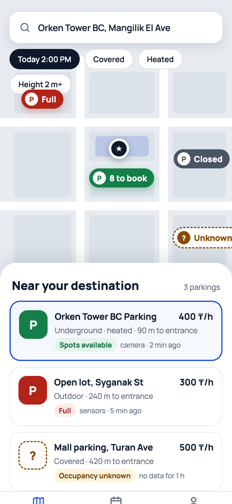
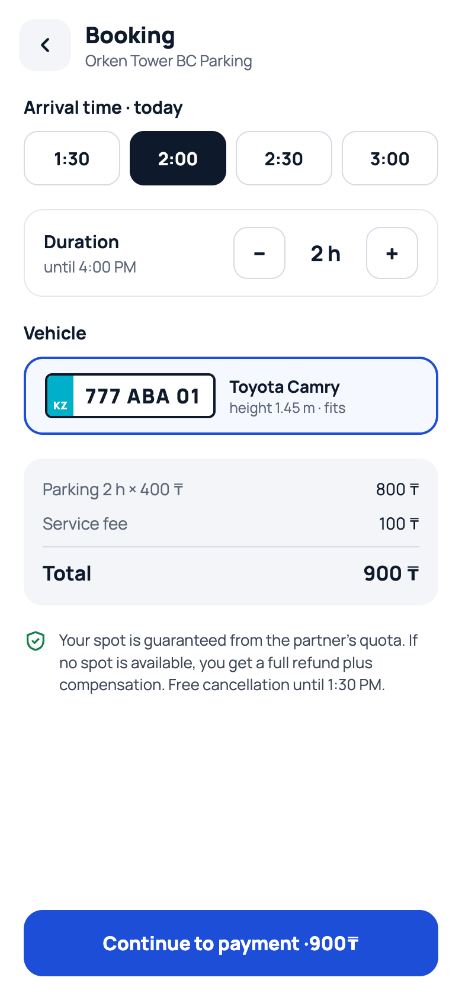
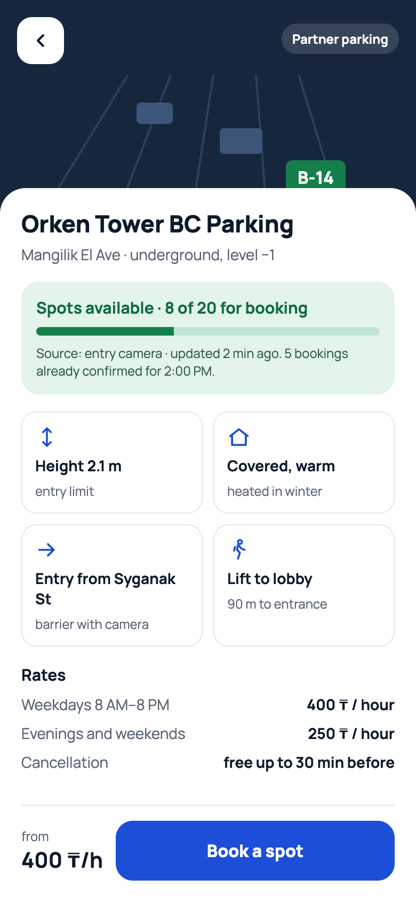
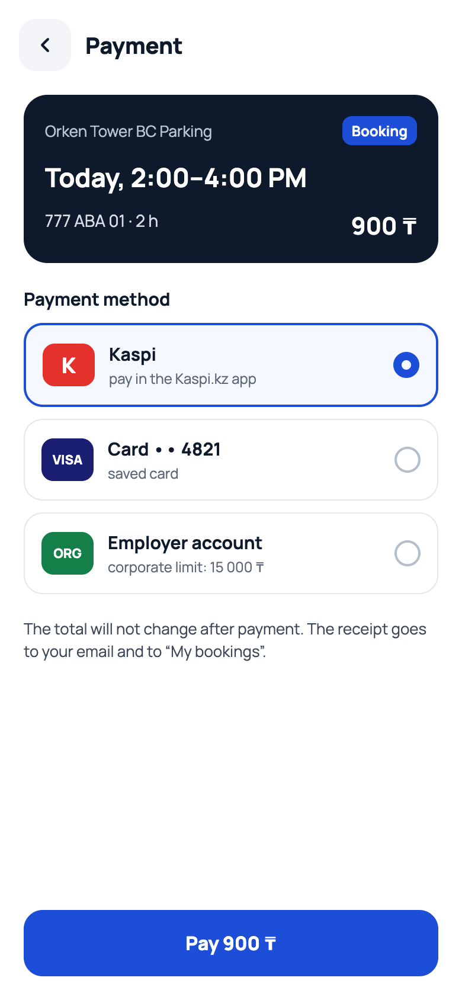
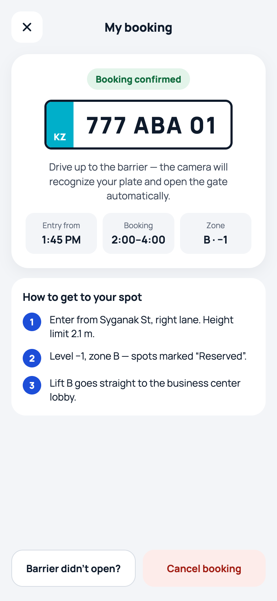
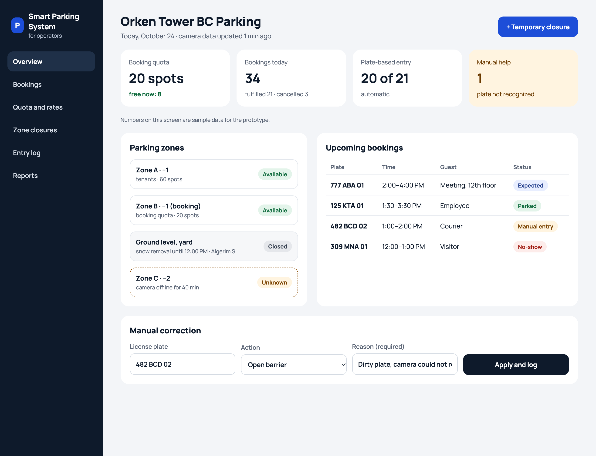

# Smart Parking System — Prototype Screens

## Screen 1. Parking map

This is the first screen the driver sees. It shows parkings near the place they are going to.

At the top is the search bar with the destination: **Orken Tower BC, Mangilik El Ave**. The destination is marked on the map with a star.

Under the search bar are filters:
- **Today 2:00 PM**: the time the driver plans to arrive. Availability is shown for this time, not only for "now".
- **Covered** and **Heated**: important in winter.
- **Height 2 m+**: for tall cars and vans.

The map shows a pin for each parking with its status:
- **8 to book** (green): 8 spots are still available for booking.
- **Full** (red): no free spots.
- **Closed** (dark gray): the operator has temporarily closed the parking.
- **Unknown** (orange, dashed outline, "?"): there is no fresh data, so the app does not guess.

At the bottom is the **"Near your destination"** panel with 3 parkings. Each card shows:
- the name and the price per hour;
- the type of parking and the walking distance to the entrance;
- the status and where the data came from, with its age.

| Parking | Price | Details | Status |
|---|---|---|---|
| Orken Tower BC Parking | 400 ₸/h | Underground · heated · 90 m to entrance | Spots available · camera · 2 min ago |
| Open lot, Syganak St | 300 ₸/h | Outdoor · 240 m to entrance | Full · sensors · 5 min ago |
| Mall parking, Turan Ave | 500 ₸/h | Covered · 420 m to entrance | Occupancy unknown · no data for 1 h |

At the very bottom is the navigation bar: **Map**, **My bookings**, **Profile**.

**Why it is designed this way:** the driver always sees not only the status but also its source and age. If the data is old, the app says **"unknown"** instead of showing an old value as current.

---

## Screen 2. Parking details

The driver taps a parking on the map and opens this screen. It answers every question the driver may have **before** driving there.

At the top is a schematic image of the parking level with the **Partner parking** label and the spot marker **B-14**.

Below is the name and location: **Orken Tower BC Parking**, Mangilik El Ave, underground, level −1.

The green block shows availability:
- **Spots available · 8 of 20 for booking**, with a progress bar.
- **Source: entry camera · updated 2 min ago**.
- **5 bookings already confirmed for 2:00 PM**. Future bookings are shown separately from current occupancy.

Four cards describe the parking:
- **Height 2.1 m**: the entry limit, so the driver knows if the car will fit.
- **Covered, warm**: heated in winter.
- **Entry from Syganak St**: the exact entrance, a barrier with a camera.
- **Lift to lobby**: 90 m to the business center entrance.

The **Rates** section:

| | |
|---|---|
| Weekdays 8 AM–8 PM | 400 ₸ / hour |
| Evenings and weekends | 250 ₸ / hour |
| Cancellation | free up to 30 min before |

At the bottom are the starting price **from 400 ₸/h** and the main button **Book a spot**.

**Why it is designed this way:** the driver learns in advance whether the car fits, which entrance to use, how far the lobby is, how much it costs and how to cancel. There are no surprises on arrival.

---

## Screen 3. Booking

After **Book a spot**, the driver chooses the time and the car.

**Arrival time · today:** four quick slots: **1:30**, **2:00** (selected), **2:30**, **3:00**.

**Duration:** a counter with **−** and **+** buttons. **2 h** is selected now, and the end time is shown: **until 4:00 PM**.

**Vehicle:** a card with the Kazakhstani license plate **777 ABA 01** and the car **Toyota Camry, height 1.45 m · fits**. The app checks the car's height against the parking's height limit.

**Price breakdown:**

| | |
|---|---|
| Parking 2 h × 400 ₸ | 800 ₸ |
| Service fee | 100 ₸ |
| **Total** | **900 ₸** |

Under the price is a guarantee with a green shield icon: *the spot is guaranteed from the partner's quota; if no spot is available, the driver gets a full refund plus compensation; free cancellation until 1:30 PM.*

At the bottom is the button **Continue to payment · 900 ₸**.

**Why it is designed this way:** the price changes instantly when the time or duration changes, and the service fee is shown as a separate line. The driver sees the final amount before paying, with no hidden costs.

---

## Screen 4. Payment

The driver chooses how to pay.

At the top is a dark booking summary card: **Orken Tower BC Parking**, the **Booking** badge, **Today, 2:00–4:00 PM**, plate **777 ABA 01 · 2 h**, total **900 ₸**.

**Payment method**, three options:
- **Kaspi**: pay in the Kaspi.kz app. It is selected by default as the most popular payment method in Kazakhstan.
- **Card •• 4821**: a saved bank card.
- **Employer account**: corporate payment with a limit of **15 000 ₸**. This is for business center employees whose company pays for their parking.

Below is a note: *the total will not change after payment; the receipt goes to email and to "My bookings".*

At the bottom is the button **Pay 900 ₸**.

**Why it is designed this way:** local payment methods are used, and the corporate account is aimed at the main users of the pilot, employees of companies in the business center.

---

## Screen 5. My booking

After payment, the driver sees the active booking. This screen takes them from the street to the parking spot.

At the top is the green **Booking confirmed** badge.

In the center is a large license plate, **777 ABA 01**. This is the plate the camera at the barrier will look for. Under it is the instruction: *drive up to the barrier, the camera will recognize your plate and open the gate automatically.*

Three tiles show the key details:
- **Entry from 1:45 PM**: the driver can enter 15 minutes before the booking starts.
- **Booking 2:00–4:00**.
- **Zone B · −1**.

The **How to get to your spot** section gives step-by-step directions:
1. Enter from Syganak St, right lane. Height limit 2.1 m.
2. Level −1, zone B: spots marked "Reserved".
3. Lift B goes straight to the business center lobby.

At the bottom are two buttons:
- **Barrier didn't open?**: a backup entry. It shows a booking code and a button to call the operator. The operator confirms entry manually, and this is saved as a "manual entry".
- **Cancel booking**: cancels the booking under the parking's cancellation rules.

**Why it is designed this way:** the main way in is automatic, by license plate. If the camera fails, the driver still has a way in through the operator and does not get stuck at the barrier.

---

## Screen 6. Operator dashboard

This is the web dashboard for the parking operator of the partner business center. On one screen the operator sees the quota, the zones, the bookings and the entry problems.

**Left menu:** Overview, Bookings, Quota and rates, Zone closures, Entry log, Reports.

**Header:** **Orken Tower BC Parking**, *Today, October 24 · camera data updated 1 min ago*. On the right is the main button **+ Temporary closure** for closing a zone because of snow, repairs or a failure.

**Four cards with key numbers:**

| Card | Value | What it means |
|---|---|---|
| Booking quota | 20 spots, free now: 8 | How many spots the partner gave for booking, and how many are free now |
| Bookings today | 34: fulfilled 21, cancelled 3 | How many bookings there were today and how they ended |
| Plate-based entry | 20 of 21, automatic | How many cars entered through the camera without help |
| Manual help | 1, plate not recognized | Highlighted in yellow: a case that needs the operator |

**Parking zones** block:

| Zone | Details | Status |
|---|---|---|
| Zone A · −1 | tenants · 60 spots | Available |
| Zone B · −1 (booking) | booking quota · 20 spots | Available |
| Ground level, yard | snow removal until 12:00 PM · Aigerim S. | Closed |
| Zone C · −2 | camera offline for 40 min | Unknown |

A closed zone always shows the reason and the responsible person. A zone without camera data is shown as **Unknown**, not as free.

**Upcoming bookings** block:

| Plate | Time | Guest | Status |
|---|---|---|---|
| 777 ABA 01 | 2:00–4:00 PM | Meeting, 12th floor | Expected |
| 125 KTA 01 | 1:30–3:30 PM | Employee | Parked |
| 482 BCD 02 | 1:00–2:00 PM | Courier | Manual entry |
| 309 MNA 01 | 12:00–1:00 PM | Visitor | No-show |

**Manual correction** block at the bottom: the operator enters a **license plate** (482 BCD 02), chooses an **action** (Open barrier) and writes a **reason** (Dirty plate, camera could not read it). The reason is required. The **Apply and log** button performs the action and saves it to the entry log.

**Why it is designed this way:** the operator steps in only when automation fails, and every manual action is saved with its reason. This makes the operator's work traceable and gives data for the pilot: how often the camera fails and how many entries needed help.
